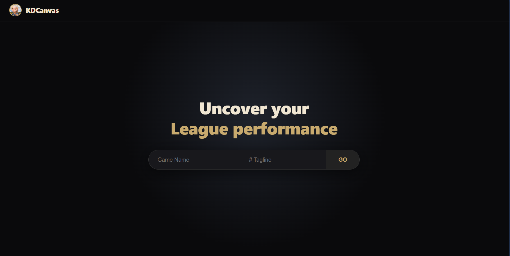
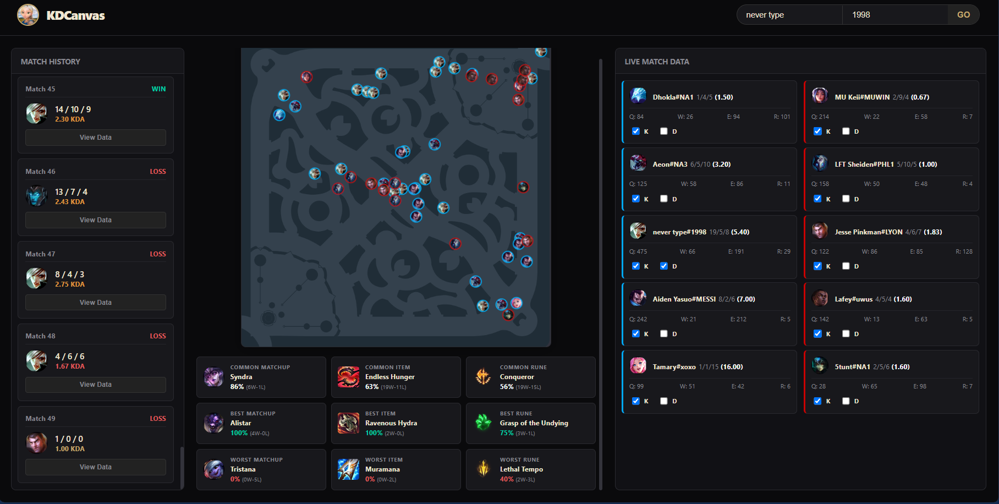
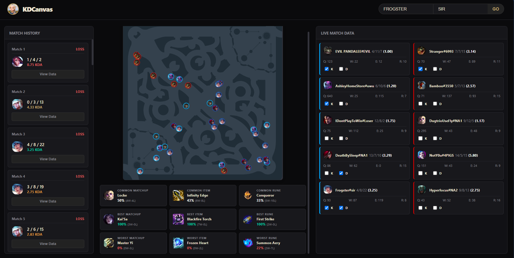

Welcome to KDCanvas!

This was just a small project I worked on over the Summer. Since the RIOT API reset's daily, I have attached screenshots as to what the landing page and data look like:

By clicking on a Match you can see a graph of where you died the most, you can also see the areas where you died often too. Theres a display to show how often an ability is used, and the K/D/A for each individual player.

In general, you can find the most common, highest winrate and lowest winrate items alongside their winrates. This shows for enemy matchups and runes as well.

Since the API only calls for 10 requests a second, I have slowed down the match generation for sustainability. If it reaches an error it will retry after the given interval.